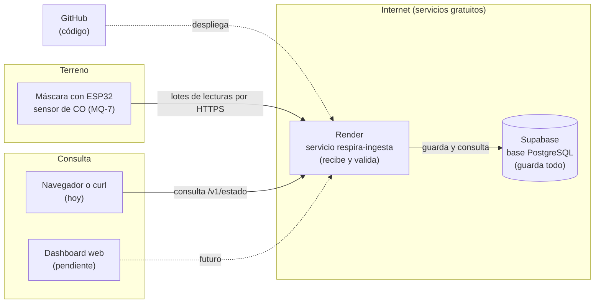
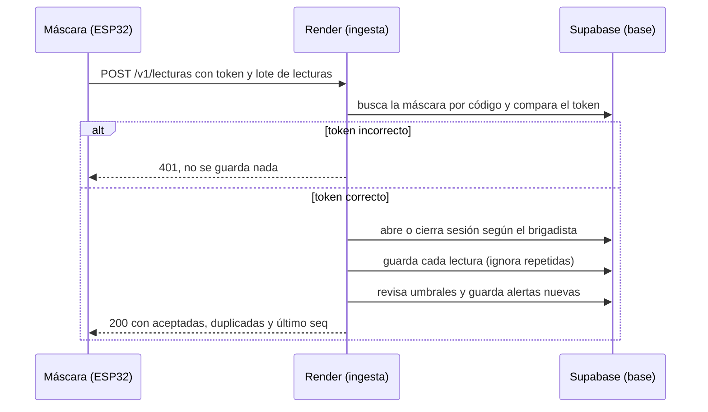
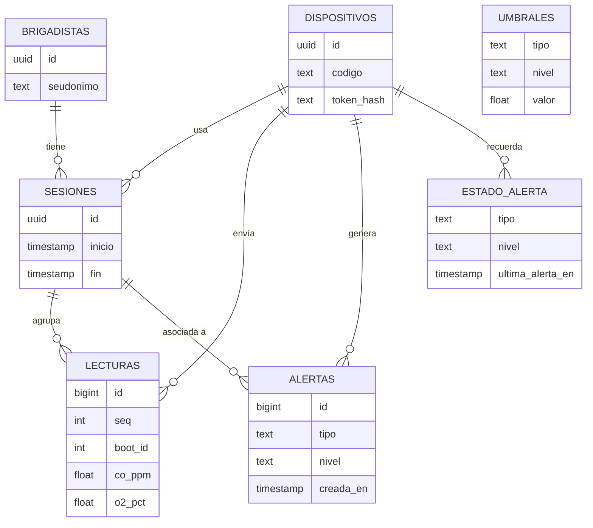
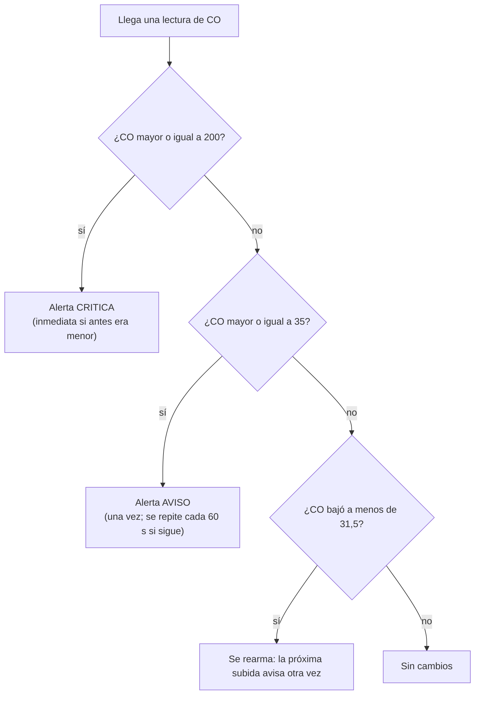

# Cómo viaja un dato desde la máscara hasta la base

Esta página muestra el camino completo de una medición, con diagramas. Los diagramas se ven directamente en GitHub.

## 1. Vista general



Lectura del diagrama: la máscara envía datos hacia Render. Render los revisa y los guarda en Supabase. Quien quiera ver el estado pide la información a Render. Las líneas punteadas son partes que todavía no están conectadas o que se conectan una vez al desplegar.

## 2. Qué pasa en cada envío (secuencia)



En palabras sencillas:
1. La máscara junta varias lecturas y las envía en un solo paquete.
2. Render comprueba que la máscara es quien dice ser, con su token secreto.
3. Cada lectura se guarda una sola vez, aunque la máscara la envíe dos veces.
4. Si algún valor supera un umbral, se crea una alerta.
5. Render responde qué recibió, para que la máscara sepa qué borrar de su memoria.

## 3. Qué guarda la base



Cada cuadro es una tabla. Las líneas muestran cómo se relacionan: un brigadista tiene muchas sesiones, una sesión agrupa muchas lecturas, etc.

| Tabla | Qué guarda, en palabras simples |
|---|---|
| `brigadistas` | Un código tipo `B-017`. Nunca el nombre. |
| `dispositivos` | Cada máscara: su código (`RESP-0001`) y el hash de su token. |
| `sesiones` | Un periodo en que una máscara está asignada a un brigadista. |
| `lecturas` | Una medición: CO, oxígeno, presión, batería, filtro, hora. |
| `alertas` | Cada aviso generado: qué pasó, cuánto valía y cuál era el umbral. |
| `estado_alerta` | Memoria de cada máscara para no repetir alertas sin motivo. |
| `umbrales` | Valores de referencia. Hoy el código usa sus propias reglas (ver [05-modificar.md](05-modificar.md)). |

Además existe la vista `ultimo_estado`, que muestra una fila por máscara con su última lectura y el brigadista asignado.

## 4. Las reglas de alerta, en simple



Por qué así:
- **No repetir la alerta en cada lectura.** Si el aviso sonara cada segundo, la central dejaría de prestarle atención.
- **Rearmar con margen (10 %).** Si el valor oscila justo en 35, no debe generar alertas todo el tiempo.
- **Repetir cada 60 segundos mientras siga alto.** Así el aviso no se pierde si nadie lo vio.

## 5. La revisión de silencio

Si una máscara con sesión abierta lleva más de 60 segundos sin enviar lecturas, la base misma crea una alerta `SIN_SENAL`. Lo hace `pg_cron`, un programa que vive dentro de Supabase y corre cada minuto. No depende de que Render esté despierto, y por eso sirve para detectar que una máscara se apagó o perdió señal.

## 6. Los tres niveles de seguridad

1. **En la máscara:** la alarma local no depende de internet. Es la protección principal del brigadista.
2. **En el envío:** cada lote tiene un token secreto por máscara. Sin token, no se guarda nada.
3. **En la base:** solo el servicio de Render escribe datos. Ninguna máscara ni ninguna persona se conecta directo a la base.

## 7. El contrato: el formato exacto del mensaje

Este es el mensaje que el ESP32 debe enviar a `POST /v1/lecturas`. Los campos que no tenga el hardware van como `null`.

```json
{
  "dispositivo": "RESP-0001",
  "boot_id": 7,
  "brigadista": "B-017",
  "lote": [
    {
      "seq": 1042,
      "epoch_s": 1793731200,
      "co_ppm": 12.4,
      "o2_pct": 20.8,
      "presion_bar": 212.0,
      "filtro_ok": true,
      "bateria_pct": 87,
      "alarma_local": false,
      "lat": null,
      "lon": null
    }
  ]
}
```

Y en el encabezado de la petición va el token: `X-Device-Token: <token de la máscara>`.

Qué significa cada campo:
- `dispositivo`: el código impreso de la máscara.
- `boot_id`: número que sube cada vez que la máscara se enciende. Evita confundir lecturas de encendidos distintos.
- `brigadista`: el seudónimo de quien usa la máscara. Si va vacío, la lectura queda sin asignar.
- `seq`: número de orden de cada lectura dentro de un mismo encendido.
- `epoch_s`: hora de la medición en segundos desde 1970. Va `null` si el reloj no está sincronizado.
- `co_ppm`: partes por millón de monóxido de carbono.
- `o2_pct`, `presion_bar`, `filtro_ok`, `bateria_pct`: oxígeno, presión del cilindro, estado del filtro y batería.
- `alarma_local`: `true` si la alarma de la máscara ya está sonando.
- `lat`, `lon`: posición, opcional.

Respuesta de Render: `{"aceptadas": 10, "duplicadas": 0, "ultimo_seq": 50}`. Si la máscara envió algo que ya estaba guardado, aparece en `duplicadas` y no genera error.
