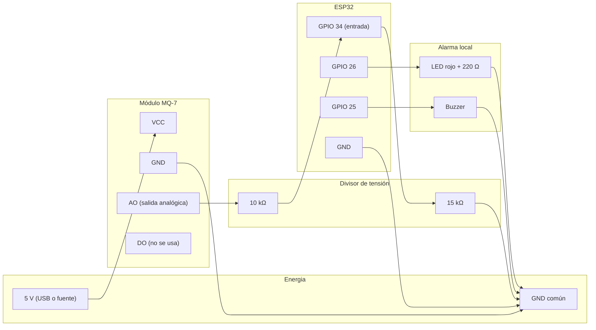

# La máscara: ESP32 y sensor MQ-7, paso a paso

Esta guía es para conectar el sensor, probarlo y dejar la máscara enviando datos a la base. Sigue los pasos en orden. No saltes el paso 1: si algo falla ahí, los siguientes no tienen sentido.

## Antes de empezar: lo importante

- **Este sensor no es un equipo de seguridad certificado.** Sirve para aprender, probar la comunicación y hacer un prototipo. No lo uses para proteger a una persona en un incendio hasta que se valide contra un detector de CO calibrado y el equipo de prevención de riesgos lo apruebe.
- **No pruebes el sensor con humo, llamas, alcohol ni gas de cocina.** El MQ-7 responde a muchos gases distintos. Esas pruebas dan números falsos y pueden ser peligrosas.
- **El ESP32 funciona a 3,3 V.** Sus pines no soportan 5 V. El MQ-7 se alimenta con 5 V, pero su salida se baja con un divisor de tensión antes de entrar al ESP32 (ver paso 2).
- **Todos los GND deben estar unidos.** Si no hay tierra común, las lecturas son basura.

## Qué necesitas (lista de compra)

| Pieza | Cantidad | Para qué |
|---|---|---|
| ESP32 DevKit (30 pines, con Wi-Fi) | 1 | El cerebro de la máscara |
| Módulo MQ-7 (placa con VCC, GND, AO, DO) | 1 | El sensor de CO |
| Resistencia de 10 kΩ | 1 | Divisor de tensión |
| Resistencia de 15 kΩ (o 10 kΩ + 4,7 kΩ en serie) | 1 | Divisor de tensión |
| LED rojo y resistencia de 220 Ω | 1 cada uno | Alarma visual local |
| Buzzer activo de 3,3 o 5 V | 1 | Alarma sonora local |
| Protoboard y cables dupont | Los necesarios | Conexiones |
| Cable USB al ESP32 y fuente de 5 V (cargador de celular de 1 A o más) | 1 | Energía |
| Computadora con Windows, Mac o Linux | 1 | Programar |

Nota sobre la fuente: el calentador del MQ-7 consume unos 150 mA a 5 V. Un cargador de celular de 1 A alcanza de sobra. Un puerto USB de computadora también sirve, pero algunos apagan el puerto si consume mucho.

## Paso 0: instalar las herramientas

1. Instala **Visual Studio Code**: https://code.visualstudio.com
2. Dentro de VS Code, ve a **Extensions** y busca **PlatformIO IDE**. Instálala y reinicia VS Code.
3. Abre la carpeta `firmware/respira-esp32` del repositorio con **File > Open Folder**.
4. PlatformIO descarga sola el compilador del ESP32 la primera vez. Tarda varios minutos.

Si no quieres usar VS Code, también funciona la línea de comandos con `pip install platformio`.

## Paso 1: configurar el firmware

1. Dentro de `firmware/respira-esp32/include/`, copia `config.example.h` como `config.h`.
2. Edita `config.h` y completa:
   - `WIFI_SSID` y `WIFI_PASSWORD`: tu red Wi-Fi. **El ESP32 solo usa redes de 2,4 GHz**, no 5 GHz.
   - `DEVICE_CODE`: el código de la máscara, por ejemplo `RESP-0002` si registras una nueva.
   - `DEVICE_TOKEN`: el token que devuelve el registro (ver paso 1.1).
   - `BRIGADISTA`: un seudónimo que exista en la base, por ejemplo `B-017`. Déjalo vacío para no asignar.
   - `SIMULATE_SENSOR`: déjalo en `1` para las primeras pruebas.
3. **No subas `config.h` a GitHub.** Ya está excluido en `.gitignore`.

### Paso 1.1: registrar tu máscara en la base

La máscara necesita su propio token. Lo genera el script de registro, que se conecta a la base con `DATABASE_URL`.

1. Entra a Supabase, abre el proyecto `respira-plus` y ve a **Connect**. Copia la cadena del **Session pooler** y reemplaza la contraseña. Pídela a quien administre el proyecto; no la pegues en chats ni en GitHub.
2. En la carpeta `ingesta` del repositorio, crea un archivo `.env` con esa cadena:

    DATABASE_URL=postgresql://postgres.<referencia>:<contraseña>@<host>:5432/postgres

3. Desde esa carpeta, con el entorno de Python listo (ver [04-replicar.md](04-replicar.md)), ejecuta:

    set -a && . ./.env && set +a
    .venv/bin/python scripts/registrar.py dispositivo RESP-0002 --version 0.1.0
    .venv/bin/python scripts/registrar.py brigadista B-017

4. Copia el token que aparece. **Se muestra una sola vez.** Pégalo en `DEVICE_TOKEN`.

Si el brigadista ya existe, el segundo comando dará error. Eso no es grave: significa que ya estaba registrado.

## Paso 2: conectar el hardware

Conecta todo con la máscara **desconectada de la energía**.

### Diagrama de conexión

### Tabla de conexiones

| Desde | Hacia | Notas |
|---|---|---|
| MQ-7 VCC | 5 V (USB del ESP32 o fuente de 5 V) | El calentador necesita 5 V |
| MQ-7 GND | GND común | Es obligatorio |
| MQ-7 AO | Una punta de la resistencia de 10 kΩ | Salida analógica del sensor |
| Otra punta de la de 10 kΩ | Pin **GPIO 34** del ESP32 y una punta de la de 15 kΩ | Este es el punto medio del divisor |
| Otra punta de la de 15 kΩ | GND común | Completa el divisor |
| MQ-7 DO | No conectar | No se usa en este firmware |
| GPIO 26 | Resistencia de 220 Ω, luego ánodo (pata larga) del LED | |
| Cátodo (pata corta) del LED | GND | |
| GPIO 25 | Buzzer, pata positiva | |
| Buzzer, pata negativa | GND | |

**Por qué el divisor:** el MQ-7 puede entregar casi 5 V en su salida. El ESP32 solo acepta 3,3 V. Con 10 kΩ y 15 kΩ, 5 V se convierten en 3 V. Verifica con un multímetro que, con el sensor sin gas y alimentado, el punto medio del divisor esté entre 0,5 V y 2,5 V. Si está fuera de ese rango, revisa las conexiones antes de seguir.

### Lista de revisión antes de encender

- [ ] MQ-7 VCC en 5 V, no en 3,3 V.
- [ ] Un solo GND común entre ESP32, MQ-7, LED y buzzer.
- [ ] GPIO 34 conectado solo al punto medio del divisor, no directo al MQ-7.
- [ ] LED con resistencia de 220 Ω. Sin resistencia, el LED puede quemarse.
- [ ] Ningún pin del ESP32 conectado a 5 V.

## Paso 3: probar la comunicación (sin sensor)

Este paso sirve para comprobar que la máscara llega a la nube, aunque el sensor no esté conectado todavía.

1. En `config.h`, deja `SIMULATE_SENSOR 1`.
2. Conecta el ESP32 por USB. Sube el firmware:
   - VS Code: botón **Upload** de PlatformIO (la flecha hacia la derecha en la barra inferior).
   - Línea de comandos: `pio run -t upload`
3. Abre el monitor serie: botón **Serial Monitor** de PlatformIO, o `pio device monitor`. Velocidad: 115200.
4. Deberías ver, en este orden:

    Respira + firmware iniciando
    Modo: SIMULADO. Boot 1. Calentamiento de 180 s antes de enviar.
    Conectando a Wi-Fi TU_RED...
    Wi-Fi conectado. IP 192.168.x.x
    Hora sincronizada por NTP.
    CO: 0.0 ppm (calentando, no se envía)
    ...

5. Después de 3 minutos, las líneas dicen `CO: x ppm` sin "(calentando...)", y aparecen mensajes `Lote de 5 enviado: HTTP 200`.
6. Revisa en la nube:

    curl https://respira-ingesta.onrender.com/v1/estado

   Debe aparecer tu máscara con un `co_ppm` que cambia.

**Si el primer envío tarda un minuto:** el servicio gratuito de Render estaba dormido. Es normal la primera vez; después responde rápido.

## Paso 4: probar la alarma local (sin red)

El modo simulado sube el CO hasta 80 ppm y luego lo baja, en ciclos de 2 minutos. Con eso se prueba la alarma:

- Por encima de 35 ppm (AVISO): el LED parpadea y el buzzer suena a pulsos.
- Por encima de 200 ppm (CRITICA): el LED queda encendido y el buzzer suena continuo. Con el modo simulado no llega a 200, así que este caso se prueba con el sensor real o cambiando `SIMULATE_SENSOR` temporalmente.

Prueba también sin red: apaga el Wi-Fi del router por unos minutos. El LED y el buzzer deben seguir funcionando, aunque el monitor diga "Sin Wi-Fi por ahora". Eso demuestra que la alarma local no depende de internet.

Cuando vuelva la red, las lecturas pendientes se envían en lotes. Aparece `Lote de 20 enviado` en el monitor.

## Paso 5: encender el sensor real

1. En `config.h`, cambia `SIMULATE_SENSOR` a `0`. Sube el firmware otra vez.
2. **Espera 3 minutos** después de encender. El sensor necesita calentar. En el monitor aparecen líneas con `(calentando, no se envía)` durante ese tiempo.
3. Mira los valores en aire limpio. Si el sensor está bien conectado, el monitor muestra valores bajos y estables, por ejemplo entre 0 y 20 ppm. Si dice `Sensor sin lectura`, el divisor o el cable de AO están mal.

**Importante:** antes de calibrar, los valores en ppm no son confiables. El firmware usa un valor de R0 de prueba (10 kΩ). Los números son orientativos.

## Paso 6: calibrar R0 en aire limpio

La calibración le dice al firmware qué resistencia tiene el sensor cuando el aire está limpio. Así puede convertir el voltaje en ppm.

1. Deja el sensor encendido 24 horas si es posible. Los sensores de óxido metálico cambian en las primeras horas. Como mínimo, espera 30 minutos.
2. Lleva la máscara a un lugar con **aire fresco y sin humo**, lejos de personas que fumen o cocinen.
3. En el monitor serie escribe `c` y envía. El firmware mide 60 segundos.
4. Anota el valor que aparece: `R0 sugerido: X kohm`.
5. En `config.h`, cambia `R0_KOHM` por ese valor. Sube el firmware otra vez.

Por qué "aire limpio": la calibración asume que el CO en el aire es prácticamente cero. Si calibras en un lugar con humo, todas las lecturas quedarán corridas.

## Paso 7: verificar que los números son reales

Este es el paso más importante y el que más se suele saltar. **Sin él, la calibración es solo una suposición.**

Lo que necesitas: un detector de CO de referencia, calibrado y con certificado. Puede ser uno de prevención de riesgos o uno de uso profesional. No se compara con un detector de hogar barato.

Procedimiento general:
1. Pon el detector de referencia y la máscara juntos, a la misma altura y en el mismo lugar.
2. Anota las lecturas de los dos durante 10 minutos en aire limpio. Deberían coincidir en un rango de error aceptable que define prevención de riesgos.
3. Solo si el equipo de prevención de riesgos lo autoriza, expón ambos a un gas de calibración con concentración conocida. Nunca uses humo, llamas o escapes de motor.
4. Si las lecturas se alejan, ajusta R0 o la curva y repite.

Mientras no se haga este paso, las lecturas de la máscara **no** se pueden usar para decidir si un brigadista se retira.

## Paso 8: revisar el flujo completo

1. La máscara lee CO cada 2 segundos.
2. Las lecturas se guardan en memoria y se envían en lotes de hasta 20.
3. La API de Render las recibe, comprueba el token y las guarda en Supabase.
4. Si supera un umbral, la base crea una alerta.
5. `curl https://respira-ingesta.onrender.com/v1/estado` muestra la última lectura.

Para comprobar desde la base, en el SQL Editor de Supabase:

    select creada_en, tipo, nivel, valor, umbral from alertas order by creada_en desc limit 10;

## Qué hacer cuando algo falla

| Síntoma en el monitor | Causa probable | Qué hacer |
|---|---|---|
| No conecta a Wi-Fi | Red de 5 GHz o clave incorrecta | Usa una red de 2,4 GHz y revisa `WIFI_SSID` y `WIFI_PASSWORD` |
| `HTTP 401` | Token incorrecto | Copia de nuevo el token del paso 1.1. Si se perdió, registra otra máscara |
| `HTTP 422` | Brigadista no registrado o inactivo | Registra el brigadista con `scripts/registrar.py brigadista` |
| `Fallo de red` o `-1` | Render dormido o sin internet | Espera un minuto. Si persiste, revisa el Wi-Fi y el estado en Render |
| Error de TLS o certificado | La hora no está sincronizada, o el certificado cambió | Revisa que aparezca "Hora sincronizada". Si Render cambió de certificado, actualiza `ROOT_CA_PEM` |
| `Sensor sin lectura` | Cable de AO o divisor mal conectado | Revisa el paso 2 con el multímetro |
| Valores siempre en 0 | MQ-7 sin 5 V o sin calentar | Revisa VCC y espera los 3 minutos |
| Valores muy altos sin motivo | Sensor sin calibrar o calibrado en aire contaminado | Repite el paso 6 en aire limpio |
| El LED y el buzzer no responden | Conexión del pin o resistencia | Revisa GPIO 26 y GPIO 25 y las tierras |

## Limitaciones que conviene conocer

- **Pérdida de datos sin red:** la memoria guarda 200 lecturas, unos 6 minutos y medio a una lectura cada 2 segundos. Si no hay red durante más tiempo, se pierden las más antiguas. Una tarjeta SD resolvería esto. Está pendiente.
- **Ciclo de calentamiento:** el firmware mantiene el calentador a 5 V todo el tiempo. Algunas hojas de datos recomiendan un ciclo de pulsos (5 V y luego 1,4 V). Esto consume más energía, pero es más estable. Está pendiente.
- **Temperatura y humedad:** el MQ-7 cambia de lectura con el clima. Para uso real hay que compensarlo.
- **Otros gases:** el sensor responde a hidrógeno, alcohol y otros. No puede distinguir CO de todo lo demás.
- **Umbrales duplicados:** los umbrales de alarma local están en `config.h` y los del servidor en `ingesta/app/reglas.py`. Si cambias uno, cambia el otro.

## Dónde se cambia cada cosa

| Quieres cambiar | Archivo | Constante |
|---|---|---|
| Red Wi-Fi | `include/config.h` | `WIFI_SSID`, `WIFI_PASSWORD` |
| Máscara o brigadista | `include/config.h` | `DEVICE_CODE`, `DEVICE_TOKEN`, `BRIGADISTA` |
| Simulación o sensor real | `include/config.h` | `SIMULATE_SENSOR` |
| Calibración | `include/config.h` | `R0_KOHM` |
| Umbrales de alarma local | `include/config.h` | `ALARMA_AVISO_PPM`, `ALARMA_CRITICA_PPM` |
| Tiempo de calentamiento | `include/config.h` | `WARMUP_SECONDS` |
| Pines | `src/main.cpp` | `PIN_MQ7`, `PIN_BUZZER`, `PIN_LED` |
| Frecuencia de lectura y envío | `src/main.cpp` | `SAMPLE_MS`, `SEND_EVERY_MS` |

Después de cambiar algo, sube el firmware otra vez con el botón **Upload** de PlatformIO.
